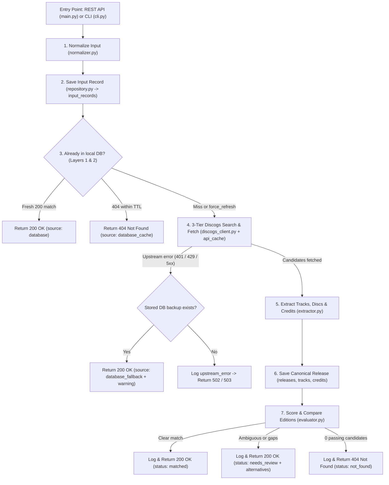
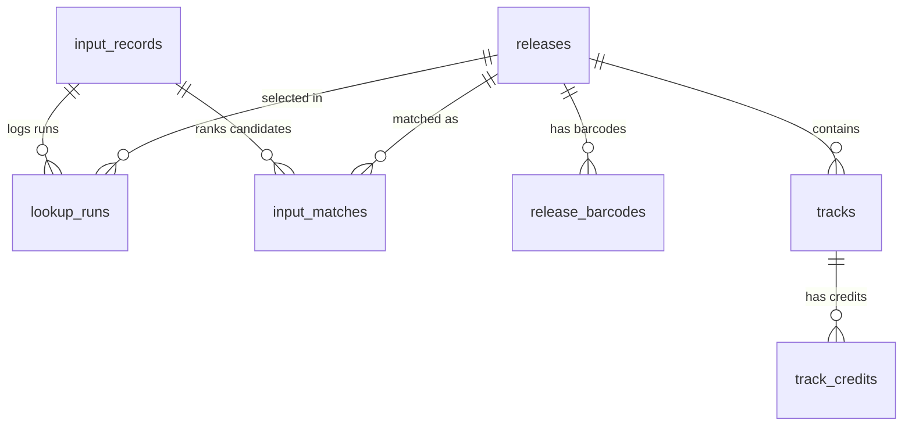

# Pipeline Component Overview

A plain-English guide to every file, module, and database table in the current **Discogs Tracklist Discovery & Evaluation Pipeline**.

---

## In 30 Seconds

The pipeline takes messy release metadata (`barcode`, `album_title`, `album_artist`), finds the matching release edition on Discogs, pulls out its ordered tracklist and separated credits, checks how trustworthy the match is, and stores everything in PostgreSQL so repeated lookups are instant.

Every run returns an honest status instead of guessing: `matched` (confident match), `needs_review` (matched, but a human should double-check diverging editions or missing details), `not_found` (404), or `upstream_error` (502/503 if Discogs fails and no local backup exists).



---

## Component Map at a Glance

| Component / File | Layer | What It Does in One Sentence |
| --- | --- | --- |
| [docker-compose.yml](../docker-compose.yml) | Infrastructure | Starts the PostgreSQL 16 database and FastAPI container together with persistent storage and volume mounts. |
| [.env.example](../.env.example) | Infrastructure | Template listing the environment variables (Discogs token, DB credentials, ports, cache limits) used by the stack. |
| [Dockerfile](pipeline/Dockerfile) & [requirements.txt](pipeline/requirements.txt) | Infrastructure | Packages the Python 3.12 runtime and pinned dependencies (`fastapi`, `uvicorn`, `httpx`, `psycopg`, `pydantic`, `pytest`). |
| [config.py](pipeline/app/config.py) | Infrastructure | Loads environment settings (DB URL, Discogs token, rate-limit floor, timeouts, TTL) into a cached `Settings` object. |
| [main.py](pipeline/app/main.py) | Entry Point | Runs the FastAPI web server, interactive Swagger UI (`/docs`), and JSON endpoints for single, batch, and DB inspection calls. |
| [cli.py](pipeline/app/cli.py) | Entry Point | Provides `python -m app.cli` commands (`lookup` and `batch`) for terminal runs and automated scripts. |
| [models.py](pipeline/app/models.py) | Data Models | Defines strict Pydantic schemas for input validation, tracks, credits, evaluation metrics, API responses, and batch reports. |
| [normalizer.py](pipeline/app/normalizer.py) | Core Logic | Cleans barcodes, artist names, titles, and format tags (`(2CD)`, `RSD`, `Various`) and hashes them into a deduplication key. |
| [service.py](pipeline/app/service.py) | Core Logic | Orchestrates the full lookup lifecycle: DB deduplication, 3-tier Discogs search, offline fallback, and CSV batch reporting. |
| [discogs_client.py](pipeline/app/discogs_client.py) | Core Logic | Talks to Discogs REST API v2 behind a swappable `CatalogProvider` interface with DB caching, rate pacing, retries, and typed errors. |
| [extractor.py](pipeline/app/extractor.py) | Core Logic | Parses raw Discogs release JSON into ordered multi-disc tracks, resolved performers, separated credit buckets, and a `tracklist_hash`. |
| [evaluator.py](pipeline/app/evaluator.py) | Core Logic | Scores candidate releases, rejects bad matches, checks whether competing editions disagree on tracks, and audits track metadata quality. |
| [init.sql](pipeline/sql/init.sql) & [repository.py](pipeline/app/repository.py) | Storage | Defines the 8-table PostgreSQL schema and runs all connection-pooled queries, upserts, and inspection lookups. |
| [tests/](pipeline/tests/) | Tests | Houses 23 unit and PostgreSQL integration tests (`pytest`) covering normalization, extraction, scoring, HTTP retries, and end-to-end flows. |

---

## How Every Component Works

### Infrastructure & Configuration

- **[docker-compose.yml](../docker-compose.yml) & [.env.example](../.env.example)**:
  - Runs two containers: `db` (`postgres:16-alpine` with a persistent `pgdata` volume, a `pg_isready` healthcheck, and automatic schema initialization from [init.sql](pipeline/sql/init.sql) on first boot) and `api` (exposed on port `8000` by default).
  - Mounts `./data` read-only at `/app/data` (for [development.csv](../data/development.csv)) and `./outputs` at `/app/outputs` (so generated batch reports appear directly on your host machine).
  - Reads settings from `.env` (see [.env.example](../.env.example)): `DISCOGS_TOKEN`, `DISCOGS_USER_AGENT`, `POSTGRES_USER`, `POSTGRES_PASSWORD`, `POSTGRES_DB`, `POSTGRES_PORT`, `API_PORT`, `NOT_FOUND_TTL_HOURS` (`24`), and `MAX_CANDIDATES_TO_FETCH` (`4`).
- **[Dockerfile](pipeline/Dockerfile) & [requirements.txt](pipeline/requirements.txt)**:
  - Builds a slim Python 3.12 image containing `app/`, `sql/`, and `tests/`, installs FastAPI, Uvicorn, HTTPX, `psycopg[binary,pool]`, Pydantic Settings, and `pytest`, and launches `uvicorn app.main:app` on port `8000`.
- **[config.py](pipeline/app/config.py)**:
  - Defines the Pydantic `Settings` class (cached via `@lru_cache`) with defaults for `database_url`, `discogs_token`, `discogs_user_agent` (`"LMUTracklistHackathon/1.0"`), `not_found_ttl_hours` (`24`), `max_candidates_to_fetch` (`4`), `discogs_timeout_sec` (`15.0`), `discogs_min_remaining` (`5`), and `discogs_base_url` (`"https://api.discogs.com"`).

### Entry Points (How You Run It)

- **Web API — [main.py](pipeline/app/main.py)**:
  - Uses FastAPI's `lifespan` hook to open a `psycopg_pool.ConnectionPool`, ensure the PostgreSQL schema exists (`repo.ensure_schema()`), instantiate `DiscogsClient` + `LookupService`, and clean them up on shutdown. Interactive docs are served automatically at `/docs`.
  - **Endpoints:**
    - `GET /health` — Pings PostgreSQL and checks if `DISCOGS_TOKEN` is configured (returns `status: "ok"` or `"degraded"` if the DB is unreachable).
    - `POST /lookup` — Runs a single release lookup; returns `200` (`matched` / `needs_review`), `404` (`not_found`), `422` (invalid request), `502` (Discogs auth/network/5xx outage without backup), or `503` (Discogs rate-limit outage without backup).
    - `POST /batch/csv` — Runs selected or all rows from a CSV file (default `/app/data/development.csv`), writes JSON and Markdown reports, and returns summary counts.
    - `GET /records` (`limit` 1–500, default `100`) — Lists stored input records with their latest lookup outcome.
    - `GET /records/{input_id}` — Shows full details for one input: run history, ranked candidate matches, selected release, and tracks.
    - `GET /releases/{discogs_release_id}` — Returns a stored canonical release and its extracted tracks/credits directly from PostgreSQL.
- **Command Line Interface — [cli.py](pipeline/app/cli.py)**:
  - Invoked via `python -m app.cli` with the same `LookupService` and database backend (plus an optional injectable `provider` for testing):
    - `lookup --barcode ... --title ... --artist ... [--refresh]` — Prints JSON to stdout and exits with `0` (`matched`/`needs_review`), `1` (`not_found`), or `2` (`upstream_error`).
    - `batch --csv ... [--rows 1,3,7,13,16] [--output /app/outputs/batch_report.json] [--refresh]` — Runs a CSV batch and prints the `BatchSummaryResponse` JSON.

### Data Contracts

- **[models.py](pipeline/app/models.py)**:
  - Holds all Pydantic v2 request, internal, and response models so inputs and outputs always follow an explicit schema:
    - `LookupRequest`: Requires at least a valid non-zero barcode or a non-empty `album_title` (so empty inputs or `"0"` barcodes without a title fail validation immediately with `422`).
    - `NormalizedInput` & `FormatHint`: Carry the cleaned fields, barcode variants, detected format hints (`medium`, `qty`, `tags`), `is_compilation` flag, and `input_hash`.
    - `LookupSuccessResponse` & `LookupNotFoundResponse`: Wrap the matched `ReleaseOut`, ordered `TrackOut` list (with `TrackArtistOut` and credit buckets of `TrackCreditOut`), `AlternativeEditionOut` list, and `EvaluationOut` metrics (or `queries_attempted` + `rejection_reasons` on `404`).
    - `BatchRequest`, `BatchRowOutcome`, `BatchSummaryResponse`, `RecordSummaryOut`, `RecordDetailOut`, and `HealthResponse`.

### Core Pipeline Stages

#### 1. Input Normalization — [normalizer.py](pipeline/app/normalizer.py)
Turns inconsistent spreadsheet/API strings into clean, comparable inputs before any search happens:
- **Barcodes:** Strips spaces, hyphens, and non-digits; treats empty values and all-zero placeholders like `"0"` as missing; generates 12-digit UPC ↔ 13-digit EAN variants (e.g., `"198028875721"` ↔ `"0198028875721"`).
- **Artists:** Maps compilation aliases (`various`, `various artists`, `va`, `v.a.`, `various (sampler)`, `sampler`) to `is_compilation=True`, `artist_norm="various"`; un-inverts trailing articles (`"Fantastischen Vier, Die"` → `"Die Fantastischen Vier"`); strips Discogs disambiguators like `"Casper (9)"`.
- **Titles & Format Hints:** Normalizes smart quotes/dashes and Unicode (`NFKC`); strips duplicated leading artist prefixes separated by `;` (e.g., `"JETHRO TULL;BALOISE SESSION(2CD)"` → `"BALOISE SESSION"`); extracts leading format prefixes (`"CD - schönhauser EP"`) and parenthetical hints (`(2CD)`, `(2LP)`, `(LP)`, `(RSD Exklusive)`, `(Deluxe)`, `(Live...)` — keeping `Live` inside the cleaned title while tagging it) into `FormatHint(medium, qty, tags)`.
- **`input_hash`:** Computes a SHA-256 hash over `(barcode_norm, title_norm, artist_norm, format_hint)` so differently formatted submissions of the same record map to one canonical `input_records` row.

#### 2. Pipeline Orchestrator — [service.py](pipeline/app/service.py)
`LookupService` connects normalization, PostgreSQL deduplication, Discogs search, extraction, evaluation, and batch reporting:
- **3-Layer Deduplication (when `force_refresh=False`):**
  1. **Same-input history:** Checks `lookup_runs` for this `input_id`. A prior `matched`/`needs_review` returns `200 OK` (`source="database"`). A prior `not_found` within `not_found_ttl_hours` (`24`h) returns `404` (`source="database_cache"`).
  2. **Cross-input local DB lookup:** Searches `release_barcodes` (all UPC/EAN variants) and `releases` (`artist_norm`, `title_norm`, or `title_norm` alone for compilations). If stored releases pass `evaluate_candidates()`, returns `200 OK` (`source="database"`) with zero Discogs calls.
  3. **Canonical release storage:** Every Discogs release is upserted once by `discogs_release_id`, so multiple inputs share one canonical release/tracklist.
- **3-Tier Discogs Search Cascade:**
  - **Tier 1 (`tier1_barcode`):** Searches `/database/search?barcode=...` across normalized barcode variants, stopping as soon as candidate IDs appear. Fetches up to `max_candidates_to_fetch` (`4`) full releases and evaluates them.
  - **Tier 2 (`tier2_structured`):** Runs if Tier 1 found no candidates **or** all Tier 1 candidates failed evaluation (e.g., empty tracklists or barcode collisions). Searches `release_title` (plus `artist` unless `is_compilation=True`).
  - **Tier 3 (`tier3_freetext`):** Runs if Tier 2 returned `0` new candidates, falling back to a general `q="<artist> <title>"` query.
- **Offline Fallback:** If Discogs throws `DiscogsError` (`401`/`403`/`429`/`5xx`/network failure), checks prior successful runs for this input and then cross-input local DB matches. If found, returns `200 OK` (`source="database_fallback"`, `fallback_used=True`, plus a `warning`) without overwriting valid `input_matches`. If no local backup exists, logs `upstream_error` and raises `UpstreamServiceError` (`503` for rate limit `429`, `502` otherwise).
- **Batch Processing (`run_batch`):** Loops through selected CSV rows, isolates per-row `UpstreamServiceError` (`upstream_error`) and `ValueError` (`validation_error`, HTTP `422`), and writes both a full JSON report and a companion Markdown summary table.

#### 3. Discogs API Client — [discogs_client.py](pipeline/app/discogs_client.py)
`DiscogsClient` implements the `CatalogProvider` protocol (making it easy to plug in additional sources like MusicBrainz later):
- **Response caching:** Hashes `(endpoint, params)` and checks PostgreSQL's `api_cache` table before sending an HTTP GET (unless `bypass_cache=True`). Only `200` responses are cached.
- **Auth & headers:** Requires a non-placeholder `DISCOGS_TOKEN` and sends mandatory `User-Agent` and `Authorization: Discogs token=...` headers.
- **Rate pacing & retries:** Reads `X-Discogs-Ratelimit-Remaining` on every response and sleeps `1.1s` when remaining quota drops to `<= discogs_min_remaining` (`5`). Retries up to 2 times on `429` (honoring `Retry-After` capped at `10s`), `5xx` errors, and transient `httpx.RequestError`s.
- **Truthful error mapping:** Treats HTTP `404` on `/releases/{id}` as `{}` (missing release), validates JSON parsing, and raises `DiscogsAuthError`, `DiscogsRateLimitError`, or `DiscogsUpstreamError` so outages are never disguised as `404 not_found`.

#### 4. Tracklist & Credit Extractor — [extractor.py](pipeline/app/extractor.py)
`extract_release()` turns raw Discogs release JSON into structured `ExtractedRelease`, `ExtractedTrack`, and `ExtractedCredit` objects:
- **Multi-disc & hierarchy handling:**
  - Reads `"heading"` items (`CD 1`, `Side B`) to update `disc_number` and `disc_label` without emitting headings as songs.
  - Infers `disc_number` from position prefixes (`1-1`, `CD2-3`), vinyl sides restricted to `A–L` (`A`/`B` = disc 1, `C`/`D` = disc 2, avoiding false disc bumps on `"V1"` video tracks), and numeric track resets (track `1` following track `>1`), carrying disc advances forward to trailing unprefixed tracks.
  - Unpacks `"index"` items' `"sub_tracks"` while retaining `parent_position` and inheriting parent artists, disc number, and parent `extraartists`.
- **Performing artists & durations:** Uses track-level `artists[]` or inherits release-level `artists[]` (`inherited=True`), joins multi-artist credits cleanly, flags `has_resolved_performer` (`False` for `"Various"`/`"Unknown"`), and parses `mm:ss` / `h:mm:ss` durations into `duration_sec` and `has_valid_duration`.
- **Separated credits:** Merges track-level `extraartists` and release-level `extraartists`:
  - `tracks == ""` → applied to every track (`credit_source="release_all"`).
  - Range strings like `"1, 3-5"`, `"A1-A3"`, `"1 to 4"`, `"01"`, en/em-dashes → matched to track positions (`credit_source="release_range"`).
  - Unparseable range strings → saved in `unscoped_credits` rather than guessed.
  - Splits multi-role strings on commas outside `[...]` qualifiers and classifies each into `composer`, `lyricist`, `producer`, `featured`, or `other` (kept separate from performing artists).
- **Fingerprints & barcodes:** Extracts normalized barcode variants from `identifiers[]` and computes `tracklist_hash` (SHA-256 over `[disc_number, normalized_title, duration_sec]` per track) to compare editions reliably.

#### 5. Candidate Evaluator — [evaluator.py](pipeline/app/evaluator.py)
Decides which fetched releases are valid matches, picks the best edition, and flags cases that need human review:
- **Rejection gates (`evaluate_candidate`):**
  - Rejects releases with `0` tracks.
  - Rejects barcode collisions where title/artist strongly contradict the input (`title_sim < 0.45` on compilations, or `title_sim < 0.25 and artist_sim < 0.25` on single acts).
  - Rejects non-barcode matches with low similarity (`title_sim < 0.65` for compilations; `title_sim < 0.55` or `artist_sim < 0.55` for single acts) or total score `< 0.65`.
- **Confidence scoring (`0.0–1.0`):**
  - **Barcode verified:** `0.55 + 0.20*title_sim + 0.15*artist_sim + 0.10*format_score + tie_breaker`.
  - **No barcode match:** `0.52*title_sim + 0.36*artist_sim + 0.12*format_score + tie_breaker`.
  - Similarity (`string_similarity`) accent-folds text and takes the maximum of `SequenceMatcher` ratio, token Jaccard overlap, containment (`0.85`), and EP-stripped title comparison. `tie_breaker` adds up to `+0.05` from `community_have` and `+0.02` for `"Complete and Correct"` / `"Correct"` data quality.
- **Edition disagreement & quality audit (`evaluate_candidates`):**
  - Sorts passing candidates by `(score, community_have)` and compares `tracklist_hash` across all passing editions.
  - If editions have different tracklists (`editions_agree=False`), auto-picks the top scorer, lists the others in `alternatives[]`, and sets `status="needs_review"` — unless the top pick is a `clear_winner` (confirmed barcode + confirmed format + beats the highest-scoring diverging edition by `>= 0.15`).
  - Also appends `review_reasons` (triggering `needs_review`) when a supplied barcode wasn't confirmed, Discogs `data_quality` is poor, any track lacks a resolved performer, inferred disc count mismatches format quantity, or requested format tags aren't confirmed.
  - Computes coverage metrics: `duration_coverage`, `performer_coverage`, `writer_credit_coverage`, and `producer_credit_coverage`.

---

### Storage Layer — [init.sql](pipeline/sql/init.sql) & [repository.py](pipeline/app/repository.py)

`PipelineRepository` wraps a `psycopg_pool.ConnectionPool` to run idempotent upserts and queries across **8 PostgreSQL tables**:

| Table | Purpose |
| --- | --- |
| `input_records` | Stores raw and normalized request fields, `format_hint`, `is_compilation`, and unique `input_hash`. |
| `releases` | Stores canonical Discogs release metadata (`discogs_release_id` PK), `tracklist_hash`, `unscoped_credits_json`, and full `raw_json`. |
| `release_barcodes` | Indexes every normalized barcode (and UPC/EAN variant) per release for fast local lookups. |
| `tracks` | Ordered tracks (`disc_number`, `position`, `entry_type`, `parent_position`, `title`, `duration_sec`, `performing_artists_json`). |
| `track_credits` | Normalized per-track credits separated by `role_category` and `credit_source` (`track`, `release_all`, `release_range`). |
| `input_matches` | Links an `input_record` to ranked candidate `releases` with scores, `is_selected`, and evaluation details. |
| `lookup_runs` | Append-only audit log of every lookup attempt (`status`, `http_code`, `source`, queries tried, review reasons, `error_detail`). |
| `api_cache` | Caches raw HTTP `200` JSON responses from Discogs keyed by SHA-256 of `(endpoint, params)`. |



---

### Automated Test Suite — [tests/](pipeline/tests/)

The suite runs via `pytest` (23 tests across 5 modules plus shared fixtures in [conftest.py](pipeline/tests/conftest.py)):

| Test File | Tests | What It Verifies |
| --- | --- | --- |
| [test_normalizer.py](pipeline/tests/test_normalizer.py) | 5 | Normalizes all 25 rows of [development.csv](../data/development.csv), barcode sanitization & UPC/EAN variants, artist un-inversion & compilations, `;` prefix/format extraction, `input_hash` stability, and `LookupRequest` rejection of empty/`"0"` inputs. |
| [test_extractor.py](pipeline/tests/test_extractor.py) | 5 | Duration & comma/bracket role parsing, multi-disc headings/prefixes/vinyl sides/implicit resets/`"V1"` safety, `sub_tracks` credit & disc merging, release-level credit range selectors + unscoped fallback, and artist `join`/`anv`. |
| [test_evaluator.py](pipeline/tests/test_evaluator.py) | 4 | `matched` vs. `clear_winner` scoring, `needs_review` on diverging editions, empty-tracklist & barcode-collision rejections, and quality/disc-mismatch/unconfirmed-barcode review flags. |
| [test_discogs_client.py](pipeline/tests/test_discogs_client.py) | 3 | Uses `httpx.MockTransport` to verify missing-token checks, required headers, `api_cache` hit/bypass, `429`/`5xx`/network retries, `401`/`404` handling, and invalid JSON errors. |
| [test_end_to_end.py](pipeline/tests/test_end_to_end.py) | 6 | Full PostgreSQL + FastAPI + CLI integration: real `DiscogsClient` + `api_cache` + UPC/EAN dedup, Tier 1 empty stub fallback to Tier 2/3, `404` TTL caching & expiry, offline DB fallback (`200`) vs. `502`/`503` outages, validation/route errors + degraded `/health`, and `/batch/csv` + CLI exit codes (`0`/`1`/`2`). |

---

## Understanding Outcomes & Source Labels

### Result Statuses (`status` & HTTP Code)

| Status | HTTP | Meaning |
| --- | --- | --- |
| `matched` | `200` | Candidate passed scoring (`>= 0.65`), tracklist is valid, and either all editions agree or one is a clear winner with no review flags. |
| `needs_review` | `200` | Best edition was selected, but a human should review it (e.g., diverging candidate tracklists, unconfirmed barcode, unresolved track performers, disc count mismatch, or poor Discogs `data_quality`). |
| `not_found` | `404` | No candidates returned or all candidates failed verification (empty tracklist, low similarity, or barcode collision). |
| `validation_error` | `422` | Input row had neither a usable non-zero barcode nor a non-empty album title. |
| `upstream_error` | `502` / `503` | Discogs failed (`401`/`403`/`5xx`/network → `502`; rate limit `429` → `503`) and no local DB backup existed. |

### Data Source Labels (`source`)

| Source Label | Meaning |
| --- | --- |
| `database` | Answered directly from PostgreSQL (exact `input_hash` match or cross-input local DB match) with 0 Discogs API calls. |
| `database_cache` | Returned a cached `404 not_found` because a prior identical search failed within `NOT_FOUND_TTL_HOURS` (default `24`h). |
| `database_fallback` | Live Discogs lookup failed, so a previously stored match was served safely (`fallback_used: true` + `warning`). |
| `discogs_cached` | Lookup ran through the search/extraction flow using cached Discogs payloads from PostgreSQL's `api_cache`. |
| `discogs_live` | Live HTTP calls were made to the Discogs API. |

---

## Quick-Start Commands

Run from the repository root (after putting your `DISCOGS_TOKEN` into `.env`):

```powershell
# 1. Start PostgreSQL + FastAPI (http://localhost:8000/docs for Swagger UI)
docker compose up -d --build

# 2. Check container health and run the automated test suite
curl.exe -s http://localhost:8000/health
docker compose exec -T api pytest -v

# 3. Look up a single record via CLI
docker compose exec api python -m app.cli lookup --barcode 4065629733131 --title Aspiral --artist EPICA

# 4. Run a batch on 5 rows from data/development.csv (writes JSON + Markdown to outputs/)
docker compose exec api python -m app.cli batch --csv /app/data/development.csv --rows 1,3,7,13,16 --output /app/outputs/dev5_report.json
```
