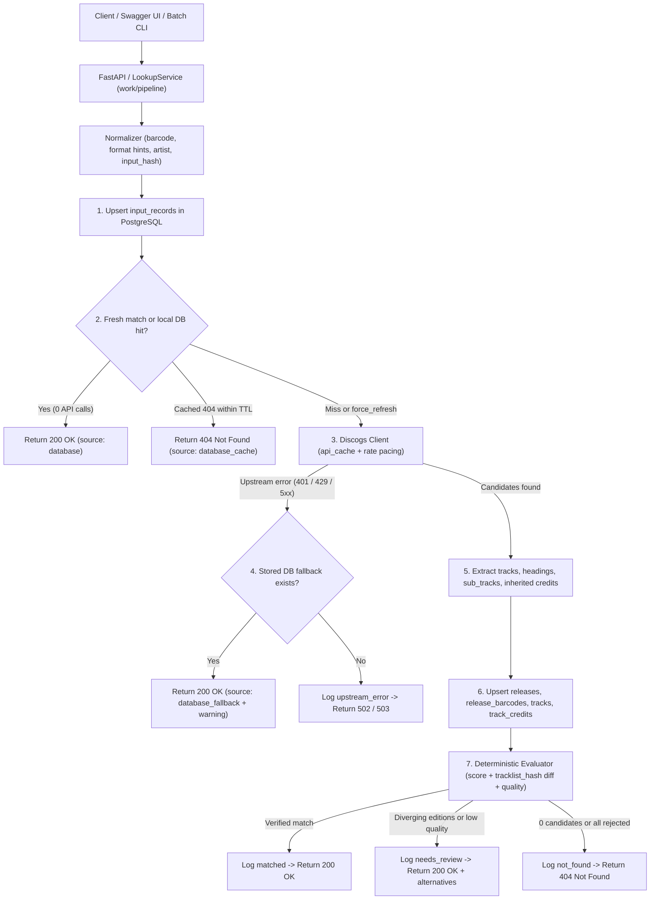

# Implementation Plan: Discogs Tracklist Discovery & Evaluation Pipeline (Docker Compose)

## Goal Description

Build a repeatable, containerized tracklist discovery and evaluation pipeline in **Docker Compose** (`PostgreSQL 16` + `FastAPI` + batch `CLI`) tailored to the GEMA *From Records to Royalties* hackathon and [development.csv](../data/development.csv).

This plan locks in the four core architectural decisions:
1. **Database:** PostgreSQL 16 container (`postgres:16-alpine`) with a persistent named volume (`pgdata`), `JSONB` columns, and normalized relational indexes—providing both durability for the prototype and a direct production path for the 1,000-record scaling pitch.
2. **Interface:** FastAPI REST API returning truthful HTTP status codes (`200` / `404` / `502` / `503`) with interactive Swagger UI (`/docs`), paired with a batch CSV runner CLI (`python -m app.cli`).
3. **Ambiguity & Multi-Edition Policy:** Deterministic candidate scoring + `tracklist_hash` cross-edition comparison; auto-picks the top-scoring edition and sets `status: "needs_review"` with `alternatives[]` whenever viable editions diverge.
4. **Source Scope (v1):** Discogs REST API v2 + local PostgreSQL deduplication/fallback only, structured behind a `CatalogProvider` protocol so secondary providers (e.g., MusicBrainz) or LLM normalizers (e.g., Gemini) can be plugged in later without refactoring storage or evaluation.

---

## User Review Required

### Credential Hygiene

> [!WARNING]
> **Unstage `api_token_discogs.md` before committing:** `git status` currently shows `api_token_discogs.md` staged (`A api_token_discogs.md`). Before committing or pushing, run `git restore --staged api_token_discogs.md`, move the token into a root `.env` file (`DISCOGS_TOKEN="..."`), and delete `api_token_discogs.md` so credentials are never committed to Git history.

### Repository Layout & Output Handling

> [!IMPORTANT]
> **File Placement:**
> - `docker-compose.yml` will be placed at the repository root so `docker compose up --build` works directly from the root and mounts `./data` and `./outputs`.
> - All pipeline source code, SQL DDL, `Dockerfile`, and `pytest` tests will live under `work/pipeline/` (following [README.md](../README.md#L453)).
> - Generated batch reports will write to `outputs/`, which is already gitignored in [.gitignore](../.gitignore#L13-L16).

### Default 5 Development Records

> [!NOTE]
> **Initial 5-Record Test Set:** Live verification will target 5 varied rows from [development.csv](../data/development.csv) while keeping remaining rows untouched for your pitch's fresh-input check:
> 1. **Row 1 (line 2):** `4065629733131,Aspiral,EPICA` — 13-digit EAN, single act
> 2. **Row 3 (line 4):** `4029759202219,JETHRO TULL;BALOISE SESSION(2CD),JETHRO TULL` — barcode + artist prefix + `;` + `(2CD)` format hint
> 3. **Row 7 (line 8):** `4262459550239,Long Player (RSD Exklusive),"Fantastischen Vier, Die"` — barcode + inverted artist + RSD hint
> 4. **Row 13 (line 14):** `4015698189711,Krautrock Eruption (An Introduction To German Electronic Music 1970-1980),Various` — compilation + barcode
> 5. **Row 16 (line 17):** `,GUTER TAG,CHEFKET` — empty barcode, single act
> *(Row 24 with `0` placeholder barcode or Row 8 with 12-digit UPC `198028875721` can be swapped in if preferred.)*

---

## Architecture & Data Flow



---

## Proposed Changes

### 1. Docker Compose & Environment

#### [NEW] docker-compose.yml
Located at the repository root; orchestrates `db` (`postgres:16-alpine`) and `api` (`work/pipeline/Dockerfile`):

```yaml
services:
  db:
    image: postgres:16-alpine
    restart: unless-stopped
    environment:
      POSTGRES_USER: ${POSTGRES_USER:-tracklist}
      POSTGRES_PASSWORD: ${POSTGRES_PASSWORD:-tracklist}
      POSTGRES_DB: ${POSTGRES_DB:-tracklist}
    ports:
      - "${POSTGRES_PORT:-5432}:5432"
    volumes:
      - pgdata:/var/lib/postgresql/data
      - ./work/pipeline/sql/init.sql:/docker-entrypoint-initdb.d/01_init.sql:ro
    healthcheck:
      test: ["CMD-SHELL", "pg_isready -U ${POSTGRES_USER:-tracklist} -d ${POSTGRES_DB:-tracklist}"]
      interval: 5s
      timeout: 3s
      retries: 10

  api:
    build:
      context: ./work/pipeline
      dockerfile: Dockerfile
    restart: unless-stopped
    depends_on:
      db:
        condition: service_healthy
    env_file:
      - path: .env
        required: false
    environment:
      DATABASE_URL: postgresql://${POSTGRES_USER:-tracklist}:${POSTGRES_PASSWORD:-tracklist}@db:5432/${POSTGRES_DB:-tracklist}
      DISCOGS_TOKEN: ${DISCOGS_TOKEN:-}
      DISCOGS_USER_AGENT: ${DISCOGS_USER_AGENT:-LMUTracklistHackathon/1.0}
      NOT_FOUND_TTL_HOURS: ${NOT_FOUND_TTL_HOURS:-24}
      MAX_CANDIDATES_TO_FETCH: ${MAX_CANDIDATES_TO_FETCH:-4}
    ports:
      - "${API_PORT:-8000}:8000"
    volumes:
      - ./data:/app/data:ro
      - ./outputs:/app/outputs

volumes:
  pgdata:
```

#### [MODIFY] [.env.example](../.env.example)
Preserve all existing Gemini/Vertex AI settings and append Discogs + Docker Compose PostgreSQL defaults:

```dotenv
# Discogs API (required for live lookup calls)
DISCOGS_TOKEN="PASTE_YOUR_DISCOGS_PERSONAL_ACCESS_TOKEN"
DISCOGS_USER_AGENT="LMUTracklistHackathon/1.0"

# Docker Compose PostgreSQL & API
POSTGRES_USER="tracklist"
POSTGRES_PASSWORD="tracklist"
POSTGRES_DB="tracklist"
POSTGRES_PORT="5432"
API_PORT="8000"
NOT_FOUND_TTL_HOURS="24"
MAX_CANDIDATES_TO_FETCH="4"
```

---

### 2. Container Packaging & PostgreSQL Schema

#### [NEW] work/pipeline/Dockerfile
```dockerfile
FROM python:3.12-slim

WORKDIR /app

COPY requirements.txt .
RUN pip install --no-cache-dir -r requirements.txt

COPY app ./app
COPY sql ./sql
COPY tests ./tests

ENV PYTHONPATH=/app
EXPOSE 8000

CMD ["uvicorn", "app.main:app", "--host", "0.0.0.0", "--port", "8000"]
```

#### [NEW] work/pipeline/requirements.txt
```text
fastapi>=0.115,<1
uvicorn[standard]>=0.32,<1
httpx>=0.27,<1
psycopg[binary,pool]>=3.2,<4
pydantic>=2.9,<3
pydantic-settings>=2.6,<3
pytest>=8.3,<9
```

#### [NEW] work/pipeline/sql/init.sql
Idempotent (`CREATE TABLE IF NOT EXISTS`) 8-table schema executed automatically on first PostgreSQL boot and verified via `ensure_schema()` on API startup:

```sql
CREATE TABLE IF NOT EXISTS input_records (
    id BIGINT GENERATED ALWAYS AS IDENTITY PRIMARY KEY,
    barcode_raw TEXT NOT NULL DEFAULT '',
    album_title_raw TEXT NOT NULL DEFAULT '',
    album_artist_raw TEXT NOT NULL DEFAULT '',
    barcode_norm TEXT NOT NULL DEFAULT '',
    title_norm TEXT NOT NULL DEFAULT '',
    artist_norm TEXT NOT NULL DEFAULT '',
    format_hint JSONB NOT NULL DEFAULT '{}'::jsonb,
    is_compilation BOOLEAN NOT NULL DEFAULT FALSE,
    input_hash TEXT NOT NULL UNIQUE,
    source_tag TEXT NOT NULL DEFAULT 'api',
    created_at TIMESTAMPTZ NOT NULL DEFAULT NOW(),
    updated_at TIMESTAMPTZ NOT NULL DEFAULT NOW()
);

CREATE INDEX IF NOT EXISTS idx_input_records_barcode_norm ON input_records (barcode_norm);
CREATE INDEX IF NOT EXISTS idx_input_records_artist_title ON input_records (artist_norm, title_norm);

CREATE TABLE IF NOT EXISTS releases (
    discogs_release_id BIGINT PRIMARY KEY,
    master_id BIGINT,
    url TEXT NOT NULL,
    resource_url TEXT NOT NULL DEFAULT '',
    title TEXT NOT NULL,
    title_norm TEXT NOT NULL,
    artist_display TEXT NOT NULL DEFAULT '',
    artist_norm TEXT NOT NULL DEFAULT '',
    year INTEGER,
    country TEXT NOT NULL DEFAULT '',
    formats_json JSONB NOT NULL DEFAULT '[]'::jsonb,
    identifiers_json JSONB NOT NULL DEFAULT '[]'::jsonb,
    labels_json JSONB NOT NULL DEFAULT '[]'::jsonb,
    data_quality TEXT NOT NULL DEFAULT '',
    community_status TEXT NOT NULL DEFAULT '',
    community_have INTEGER NOT NULL DEFAULT 0,
    community_want INTEGER NOT NULL DEFAULT 0,
    notes TEXT NOT NULL DEFAULT '',
    track_count INTEGER NOT NULL DEFAULT 0,
    tracklist_hash TEXT NOT NULL DEFAULT '',
    unscoped_credits_json JSONB NOT NULL DEFAULT '[]'::jsonb,
    raw_json JSONB NOT NULL,
    fetched_at TIMESTAMPTZ NOT NULL DEFAULT NOW()
);

CREATE INDEX IF NOT EXISTS idx_releases_artist_title ON releases (artist_norm, title_norm);
CREATE INDEX IF NOT EXISTS idx_releases_tracklist_hash ON releases (tracklist_hash);

CREATE TABLE IF NOT EXISTS release_barcodes (
    discogs_release_id BIGINT NOT NULL REFERENCES releases(discogs_release_id) ON DELETE CASCADE,
    barcode_norm TEXT NOT NULL,
    barcode_raw TEXT NOT NULL DEFAULT '',
    PRIMARY KEY (discogs_release_id, barcode_norm)
);

CREATE INDEX IF NOT EXISTS idx_release_barcodes_norm ON release_barcodes (barcode_norm);

CREATE TABLE IF NOT EXISTS tracks (
    id BIGINT GENERATED ALWAYS AS IDENTITY PRIMARY KEY,
    discogs_release_id BIGINT NOT NULL REFERENCES releases(discogs_release_id) ON DELETE CASCADE,
    track_order INTEGER NOT NULL,
    disc_number INTEGER NOT NULL DEFAULT 1,
    disc_label TEXT NOT NULL DEFAULT '',
    position TEXT NOT NULL DEFAULT '',
    entry_type TEXT NOT NULL DEFAULT 'track',
    parent_position TEXT NOT NULL DEFAULT '',
    title TEXT NOT NULL,
    duration_raw TEXT NOT NULL DEFAULT '',
    duration_sec INTEGER,
    performing_artists_json JSONB NOT NULL DEFAULT '[]'::jsonb,
    performing_artist_display TEXT NOT NULL DEFAULT '',
    has_valid_duration BOOLEAN NOT NULL DEFAULT FALSE,
    has_resolved_performer BOOLEAN NOT NULL DEFAULT FALSE,
    UNIQUE (discogs_release_id, track_order)
);

CREATE TABLE IF NOT EXISTS track_credits (
    id BIGINT GENERATED ALWAYS AS IDENTITY PRIMARY KEY,
    track_id BIGINT NOT NULL REFERENCES tracks(id) ON DELETE CASCADE,
    discogs_artist_id BIGINT,
    artist_name TEXT NOT NULL,
    anv TEXT NOT NULL DEFAULT '',
    role_raw TEXT NOT NULL,
    role_category TEXT NOT NULL,
    credit_source TEXT NOT NULL,
    UNIQUE (track_id, artist_name, role_raw, credit_source)
);

CREATE TABLE IF NOT EXISTS input_matches (
    id BIGINT GENERATED ALWAYS AS IDENTITY PRIMARY KEY,
    input_id BIGINT NOT NULL REFERENCES input_records(id) ON DELETE CASCADE,
    discogs_release_id BIGINT NOT NULL REFERENCES releases(discogs_release_id) ON DELETE CASCADE,
    is_selected BOOLEAN NOT NULL DEFAULT FALSE,
    match_rank INTEGER NOT NULL,
    match_method TEXT NOT NULL,
    score DOUBLE PRECISION NOT NULL,
    evaluation_json JSONB NOT NULL DEFAULT '{}'::jsonb,
    created_at TIMESTAMPTZ NOT NULL DEFAULT NOW(),
    UNIQUE (input_id, discogs_release_id)
);

CREATE TABLE IF NOT EXISTS lookup_runs (
    id BIGINT GENERATED ALWAYS AS IDENTITY PRIMARY KEY,
    input_id BIGINT NOT NULL REFERENCES input_records(id) ON DELETE CASCADE,
    status TEXT NOT NULL,
    http_code INTEGER NOT NULL,
    source TEXT NOT NULL,
    selected_release_id BIGINT REFERENCES releases(discogs_release_id) ON DELETE SET NULL,
    queries_attempted_json JSONB NOT NULL DEFAULT '[]'::jsonb,
    candidates_checked INTEGER NOT NULL DEFAULT 0,
    evaluation_summary_json JSONB NOT NULL DEFAULT '{}'::jsonb,
    review_reasons_json JSONB NOT NULL DEFAULT '[]'::jsonb,
    error_detail TEXT NOT NULL DEFAULT '',
    created_at TIMESTAMPTZ NOT NULL DEFAULT NOW()
);

CREATE INDEX IF NOT EXISTS idx_lookup_runs_input_created ON lookup_runs (input_id, created_at DESC);

CREATE TABLE IF NOT EXISTS api_cache (
    cache_key TEXT PRIMARY KEY,
    endpoint TEXT NOT NULL,
    status_code INTEGER NOT NULL,
    payload_json JSONB NOT NULL,
    fetched_at TIMESTAMPTZ NOT NULL DEFAULT NOW()
);
```

---

### 3. Core Pipeline Application (`work/pipeline/app/`)

#### [NEW] work/pipeline/app/config.py
Uses `pydantic-settings` to configure `database_url`, `discogs_token`, `discogs_user_agent`, `not_found_ttl_hours` (default `24`), `max_candidates_to_fetch` (default `4`), `discogs_timeout_sec` (default `15.0`), and `discogs_min_remaining` (default `5`).

#### [NEW] work/pipeline/app/models.py
Strict Pydantic models for requests, domain objects, and HTTP responses:
- `LookupRequest(barcode="", album_title="", album_artist="", force_refresh=False)` validating that at least one usable identifier or title exists.
- **HTTP `200` (`LookupSuccessResponse`):**
  ```json
  {
    "status": "matched",
    "http_code": 200,
    "source": "discogs_live",
    "fallback_used": false,
    "warning": null,
    "input_id": 1,
    "release": {
      "discogs_release_id": 123456,
      "master_id": 654321,
      "url": "https://www.discogs.com/release/123456",
      "title": "...",
      "artist_display": "...",
      "year": 2025,
      "country": "Germany",
      "formats": [],
      "data_quality": "Correct",
      "community_have": 42
    },
    "tracks": [],
    "alternatives": [],
    "evaluation": {
      "match_confidence": 0.94,
      "match_method": "barcode_exact",
      "candidates_checked": 2,
      "editions_agree": true,
      "track_count": 11,
      "duration_coverage": 1.0,
      "performer_coverage": 1.0,
      "writer_credit_coverage": 0.82,
      "producer_credit_coverage": 0.82,
      "disc_format_consistent": true,
      "discogs_data_quality": "Correct",
      "review_reasons": []
    }
  }
  ```
- **HTTP `404` (`LookupNotFoundResponse`):**
  ```json
  {
    "status": "not_found",
    "http_code": 404,
    "source": "discogs_live",
    "input_id": 2,
    "queries_attempted": [],
    "candidates_checked": 0,
    "rejection_reasons": []
  }
  ```
- **HTTP `502` / `503`:** Returned cleanly with `error_type` and `detail` whenever upstream fails (`401`/`403`/`429`/`5xx`/timeout) and no local DB fallback exists.

#### [NEW] work/pipeline/app/normalizer.py
Deterministic pre-processing tuned to [development.csv](../data/development.csv):
- **Barcodes:** Strip spaces, hyphens, and non-digit characters; treat `""` and all-zeros (`"0"`) as missing; produce `barcode_variants()` handling 12-digit UPC ↔ 13-digit EAN leading-`0` conversions (`198028875721` ↔ `0198028875721`).
- **Title & format hints:** Extract format markers (`(2CD)`, `(2LP)`, `(LP)`, `(CD)`, `(EP)`, `(RSD Exklusive)`, leading `CD - `) into structured `format_hint` (`{"medium": "CD", "qty": 2, "tags": ["2CD"]}`), strip duplicated artist prefixes before `;` (`JETHRO TULL;BALOISE SESSION(2CD)` → `BALOISE SESSION`), and normalize typographic quotes (`‘`/`’` → `'`).
- **Artists:** Map compilation indicators (`various`, `various artists`, `va`, `various (sampler)`) to `is_compilation=True`, `artist_norm="various"`; un-invert trailing articles (`"Fantastischen Vier, Die"` → `"Die Fantastischen Vier"`); strip Discogs disambiguators like `Casper (9)` during comparison.
- **`input_hash`:** SHA-256 over `(barcode_norm, title_norm, artist_norm, canonical_format_hint)`.

#### [NEW] work/pipeline/app/discogs_client.py
Direct `httpx.Client` adapter behind a `CatalogProvider` protocol (clean extension hook for future sources):
- Sends mandatory `User-Agent` and `Authorization: Discogs token=...` headers.
- Checks `api_cache` in PostgreSQL before any live HTTP GET (unless `bypass_cache=True`).
- Reads `X-Discogs-Ratelimit-Remaining` on every live response, pacing automatically when remaining drops to `<= discogs_min_remaining`, with bounded exponential backoff on `429`/`5xx`.
- Raises typed errors (`DiscogsAuthError`, `DiscogsRateLimitError`, `DiscogsUpstreamError`) so upstream failures are never misclassified as `404`.

#### [NEW] work/pipeline/app/extractor.py
Extracts **all available per-track information** from `GET /releases/{id}`:
- Walks `tracklist[]` sequentially:
  - Tracks `"heading"` items (`CD 1`, `CD 2`, `Side B`) to assign `disc_number` and `disc_label` without emitting headings as songs.
  - Infers `disc_number` from position prefixes (`1-1`, `CD2-3`) or vinyl sides (`A/B` → 1, `C/D` → 2, `E/F` → 3) when headings are absent.
  - Unpacks `"index"` entries' `"sub_tracks"` while preserving `parent_position`.
- Resolves `performing_artists`: uses track-level `artists[]` when present, otherwise inherits release-level `artists[]` (`inherited=True`), capturing `id`, `name`, `anv`, and `join`.
- Parses `duration` (`mm:ss` / `h:mm:ss`) into `duration_sec` and `has_valid_duration`.
- Merges **both** track-level `extraartists[]` and release-level `extraartists[]`:
  - `tracks == ""` → applies to every track (`credit_source="release_all"`).
  - Range selectors (e.g., `"1, 3-5"`, `"A1-A3"`, `"1 to 4"`) → matched to track positions (`credit_source="release_range"`).
  - Unparseable range strings → preserved in `unscoped_credits_json` instead of guessing.
- Splits multi-role strings on `,`, strips `[...]` qualifiers, and classifies into `composer`, `lyricist`, `producer`, `featured`, and `other`.
- Computes `tracklist_hash` over normalized `(disc_number, title_norm, duration_sec)` and extracts all normalized barcode variants from `identifiers[]`.

#### [NEW] work/pipeline/app/evaluator.py
Deterministic candidate scoring & per-track audit:
- **Candidate score (`0.0–1.0`):** Combines verified `identifiers[]` barcode match (exact or 12↔13 variant), artist similarity (plus compilation sanity check that tracks resolve to real non-`"Various"` performers), title similarity, format/disc count alignment (`(2CD)` ↔ `CD qty=2` & 2 discs in tracklist), and `community_have`/`data_quality` tie-breakers.
- **Verification gate:** Rejects candidates with `0` real tracks or score below threshold (or contradicting artist/title on barcode collision), logging human-readable `rejection_reasons`.
- **Ambiguity policy:** Compares `tracklist_hash` across passing candidates:
  - Single passing candidate or identical `tracklist_hash` across passing candidates → `status = "matched"`.
  - Diverging `tracklist_hash`es → auto-picks top candidate and sets `status = "needs_review"` with `alternatives[]` (unless top candidate wins unambiguously by verified barcode + format hint with score margin `>= 0.15`).
- **Per-track evaluation metrics:** Computes `track_count`, `duration_coverage`, `performer_coverage`, `writer_credit_coverage`, `producer_credit_coverage`, `disc_format_consistent`, `discogs_data_quality`, `editions_agree`, and `review_reasons`.

#### [NEW] work/pipeline/app/repository.py & work/pipeline/app/service.py
- **3-layer deduplication:**
  1. Exact `input_hash` lookup in `input_records` + `lookup_runs` / `input_matches`.
  2. Cross-input local DB lookup via `release_barcodes` (including leading-`0` variant) or normalized `(artist_norm, title_norm)` in `releases`.
  3. Canonical `UPSERT` on `discogs_release_id` so multiple input rows link to one stored release and tracklist.
- **3-tier Discogs search cascade:**
  - Tier 1: `/database/search?barcode=...&type=release` (exact normalized digits, then 12↔13 leading-`0` variant).
  - Tier 2: `/database/search?release_title=...&artist=...&type=release` (omitting `artist` when `is_compilation=True`).
  - Tier 3: `/database/search?q=...&type=release` relaxed fallback.
- **Offline fallback:** On `DiscogsAuthError`, `DiscogsRateLimitError`, or `DiscogsUpstreamError`, checks prior matches by `input_hash`, `release_barcodes`, or `(artist_norm, title_norm)`; if found, returns `200` with `source="database_fallback"`, `fallback_used=True`, and a warning without overwriting valid cached rows; otherwise logs `upstream_error` and returns `502`/`503`.

#### [NEW] work/pipeline/app/main.py & work/pipeline/app/cli.py
- **FastAPI endpoints:**
  - `GET /health` — DB connectivity & `discogs_token_configured` flag.
  - `POST /lookup` — runs pipeline; returns `200`, `404`, or `502`/`503`.
  - `POST /batch/csv` — runs selected rows from `/app/data/development.csv`, writes JSON + Markdown pitch reports to `/app/outputs/`, and returns summary metrics.
  - `GET /records`, `GET /records/{input_id}`, `GET /releases/{discogs_release_id}` — inspect stored inputs, run history, extracted tracks, credits, and evaluation metrics.
- **CLI runner (`python -m app.cli`):**
  - `lookup --barcode ... --title ... --artist ... [--refresh]`
  - `batch --csv /app/data/development.csv --rows 1,3,7,13,16 --output /app/outputs/dev5_report.json`

---

### 4. Automated Test Suite

#### [NEW] work/pipeline/tests/test_pipeline.py
Unit and PostgreSQL integration tests covering:
- Input normalization edge cases from [development.csv](../data/development.csv) (`"0"` barcode, 12↔13-digit UPC/EAN, `JETHRO TULL;BALOISE SESSION(2CD)`, `"Fantastischen Vier, Die"`, compilation aliases).
- Full per-track extraction (`"heading"` disc tracking, `"index"`/`"sub_tracks"` unpacking, inherited release `artists`, scoped `release.extraartists` range parsing `"1, 3-5"` & `"A1-A3"`, role categorization).
- Deterministic evaluation (`matched`, `needs_review` with `alternatives[]`, empty tracklist / false-positive rejection → `404`).
- PostgreSQL persistence, 3-layer deduplication (repeat and normalized-variant lookups trigger `0` Discogs calls), and offline DB fallback returning `200` (`fallback_used=True`) on mocked `429`/`503` failures (and `502` on uncached records).

---

## Verification Plan

### Automated Tests
Run from the repository root:

```powershell
docker compose up -d --build
docker compose exec api pytest -v
curl.exe -s http://localhost:8000/health
```

### Live & Manual Verification (after placing `DISCOGS_TOKEN` in `.env`)
1. **Batch test on 5 varied records** from [development.csv](../data/development.csv):
   ```powershell
   docker compose exec api python -m app.cli batch --csv /app/data/development.csv --rows 1,3,7,13,16 --output /app/outputs/dev5_report.json
   ```
   Inspect `outputs/dev5_report.json` and `GET http://localhost:8000/records` to verify matched editions, Discogs source links, tracks, durations, separated credits, and evaluation scores.
2. **Deduplication verification:** Re-run the same 5 rows (and submit a variant like `"Die Fantastischen Vier"` instead of `"Fantastischen Vier, Die"`) and verify `source: "database"` with `0` new Discogs API calls.
3. **`404 Not Found` verification:** Submit a nonexistent album via Swagger UI (`http://localhost:8000/docs`) on `POST /lookup`; verify HTTP `404` with `queries_attempted` and `rejection_reasons`, plus persisted `input_records` and `lookup_runs` rows.
4. **Offline fallback verification:** Temporarily test with an unreachable/invalid token + `force_refresh: true` on a previously matched record and confirm HTTP `200` with `source: "database_fallback"` and `fallback_used: true` (and HTTP `502` on an uncached record rather than a false `404`).

---

## Scaling Notes (For the 1,000-Record Pitch)

- **Live API baseline:** Discogs authenticates at **60 requests/min**. At ~2–4 API calls per record (search + top candidate `/releases/{id}`), 1,000 records take **~35–65 minutes** sequentially at \$0 Discogs API fee, with PostgreSQL deduplication + `api_cache` eliminating repeat calls for duplicate/re-submitted titles.
- **Production upgrade path:** Discogs publishes monthly **CC0** XML dumps (`releases.xml.gz`, ~10.1–10.3 GB compressed) matching the same schema. Ingesting the monthly dump into the exact same PostgreSQL `releases`, `release_barcodes`, `tracks`, and `track_credits` tables enables millisecond local lookups at 1,000+ or 100,000+ scale, reserving the live Discogs API strictly for brand-new releases published since the last dump.
